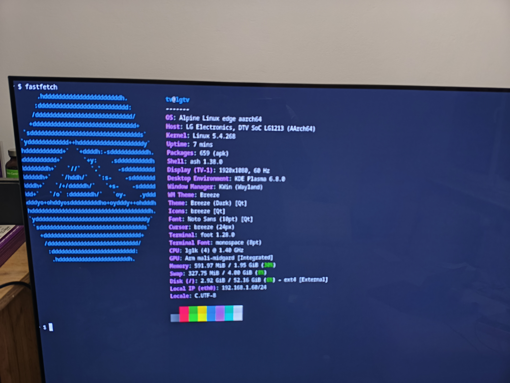

# About this project

This project is attempting to boot custom linux on LG smart TV (OLED65C21LA). This project uses kexec to execute custom kernel in memory without any need to override system files present in stock os.



# Building and running

Build everything, then deploy and boot in one command:

```sh
sh alpine/build.sh         # kexec, busybox, boot initramfs, alpine rootfs
sh boot.sh 192.168.1.60    # sync changed files to the TV, then kexec into them
```

`boot.sh` copies only the files whose hashes differ from the TV's copies, and pipes the
per-unit values (`tv-env.sh`, gitignored) over ssh rather than storing them on the
television. Stock webOS is untouched — power-cycle the TV and it comes back normally.

Full instructions, including the kernel build and writing the Alpine USB stick, are in
[docs/INSTALL.md](docs/INSTALL.md). [docs/REPO.md](docs/REPO.md) says what every file in
here is for.

# State of the project

Currently the project is in Proof Of Concept stage.

## What is working

* kexec boot of modified stock kernel
* booting alpine os
* UART and telnet connection to shell
* internet over ethernet
* basic GPU support
* basic audio support
* working plasma bigscreen

## What is not working
There is a lot left to be done but some of current priorities are:

* on screen beyboard - plasma bigscreen should have it by default but it is not working
* magic remote as a mouse and controller
* better bluetooth support - bt keyboard sometimes works but not always. need to debug
* audio level control
* full gpu support - currently screen sometimes changes to single color. moving a mouse fixes it temporarily.
* Proper audio set up: now there is some race condition which causes some of dsp's to fail during boot which necessitates a reboot.
* Safe reboot - now tv thinks it crashed if we reboot from our os. Probably need to inform micom about safe turn off.
* only 15 fps for 4k
* And more :)

# AI disclosure
A lot of the code in this repo is AI generated so use with care.